<p align="center">
  
</p>

<h1 align="center">SalonHub</h1>

<p align="center">
  Aplikasi mobile untuk menemukan barbershop, melihat barber di sekitar, dan mendapatkan rute menuju lokasi pilihan.
</p>

<p align="center">
  
  
  
  
</p>

<p align="center">
  
  
  
  
</p>

## Tentang Project

SalonHub adalah project Flutter yang dibuat untuk mengeksplorasi pengalaman booking barbershop dengan tampilan modern dan alur yang sederhana. Saat ini fokus utama project adalah implementasi UI, navigasi, state management, map, dan prototype pencarian barber.

Fitur backend dan logic bisnis masih dapat dikembangkan lebih lanjut.

## Fitur Utama

- Intro screen dan alur autentikasi: login, register, lupa password, dan OTP.
- Home screen dengan promo, rekomendasi barbershop, serta preview map barber di sekitar.
- Halaman **Cari Barber** dengan map interaktif berbasis OpenStreetMap.
- Marker barbershop yang dapat dipilih dan berubah ke warna `primary900`.
- Search bar yang dapat diketik dan daftar recent search.
- Bottom sheet draggable untuk menampilkan lokasi serta rekomendasi barber.
- Tombol lokasi pengguna dengan success toast berbahasa Indonesia.
- Rute jalan dari lokasi pengguna menuju barbershop menggunakan OSRM.
- Asset icon SVG dan font Plus Jakarta Sans untuk menjaga konsistensi visual.

## Tech Stack

<p align="center">
  <a href="https://flutter.dev/"></a>
  <a href="https://dart.dev/"></a>
  <a href="https://github.com/jonataslaw/getx"></a>
  <a href="https://pub.dev/packages/flutter_map"></a>
  <a href="https://www.openstreetmap.org/"></a>
</p>

| Teknologi | Peran |
| --- | --- |
| Flutter | Framework aplikasi multiplatform |
| Dart | Bahasa pemrograman |
| GetX | State management, dependency injection, dan routing |
| flutter_map | Menampilkan map dan polyline |
| latlong2 | Representasi koordinat geografis |
| flutter_svg | Rendering icon dan asset SVG |
| OpenStreetMap | Sumber tile map |
| OSRM | Menghasilkan rute jalan dari titik awal ke tujuan |
| Plus Jakarta Sans | Font utama aplikasi |

## Package yang Digunakan

| Package | Versi | Kegunaan |
| --- | --- | --- |
| [`get`](https://pub.dev/packages/get) | `^4.7.3` | GetX architecture, reactive state, binding, dan navigation |
| [`introduction_screen`](https://pub.dev/packages/introduction_screen) | `^4.0.0` | Halaman intro/onboarding |
| [`flutter_svg`](https://pub.dev/packages/flutter_svg) | `^2.3.0` | Menampilkan icon SVG dari asset desain |
| [`flutter_map`](https://pub.dev/packages/flutter_map) | `^8.3.2` | Map, marker, dan polyline route |
| [`latlong2`](https://pub.dev/packages/latlong2) | `^0.10.1` | Data latitude dan longitude |
| [`cupertino_icons`](https://pub.dev/packages/cupertino_icons) | `^1.0.8` | Icon bergaya Cupertino |

## Arsitektur GetX

Struktur utama project mengikuti pola modular GetX:

```text
lib/
├── app/
│   ├── constant/       # Theme dan konstanta aplikasi
│   ├── models/         # Model data
│   ├── modules/        # Feature module: view, controller, binding
│   ├── providers/      # Provider untuk komunikasi API
│   ├── routes/         # App pages dan route name
│   └── widgets/        # Widget reusable
├── assets/             # Gambar dan icon SVG
└── main.dart           # Entry point aplikasi
```

Provider API dipisahkan ke folder `lib/app/providers/`. Contoh provider routing:

```text
lib/app/providers/routing_provider.dart
```

Provider tersebut menggunakan `GetConnect` untuk meminta rute jalan dari OSRM, sedangkan controller hanya bertugas mengelola state dan memperbarui tampilan.

## Map dan Routing

Map menggunakan tile OpenStreetMap melalui `flutter_map`. Ketika marker barbershop dipilih, aplikasi meminta koordinat route ke OSRM melalui endpoint driving route, lalu menggambar hasil geometry jalan sebagai polyline berwarna `primary900`.

Alur sederhananya:

```text
Lokasi pengguna
      │
      ▼
RoutingProvider (GetConnect)
      │
      ▼
OSRM route API
      │
      ▼
Polyline jalan pada flutter_map
```

> Catatan: OSRM dan OpenStreetMap yang digunakan saat ini merupakan layanan publik. Untuk production, sebaiknya siapkan backend/proxy sendiri dan perhatikan kebijakan penggunaan serta rate limit masing-masing layanan.

## Tools yang Digunakan

<p align="center">
  
</p>

<p align="center">
  <b>Dikembangkan dengan Neovim</b>
</p>

<p align="center">
  <a href="https://neovim.io/"></a>
  <a href="https://nvchad.com/"></a>
  <a href="https://git-scm.com/"></a>
  <a href="https://pub.dev/"></a>
</p>

| Tool | Fungsi |
| --- | --- |
| Neovim | Editor utama untuk development |
| NvChad | Base konfigurasi Neovim |
| Git | Version control |
| Flutter CLI | Menjalankan, menganalisis, dan build aplikasi |
| pub.dev | Registry package Dart/Flutter |

## Menjalankan Project

Pastikan Flutter dan Dart sudah terpasang, kemudian jalankan:

```bash
flutter pub get
flutter run
```

Untuk melihat device yang tersedia:

```bash
flutter devices
```

Untuk validasi kode dan build debug Linux:

```bash
flutter analyze
flutter build linux --debug
```

## Catatan Asset

- Logo utama aplikasi berada di [`lib/assets/logo.png`](lib/assets/logo.png).
- Icon UI berada di [`lib/assets/icons/`](lib/assets/icons/).
- Font utama berada di `assets/fonts/PlusJakartaSans-Variable.ttf`.
- Pastikan semua gambar, font, dan asset yang akan dipublikasikan memiliki lisensi atau izin penggunaan yang sesuai.

## Status Pengembangan

Project ini masih berada pada tahap UI prototype. Beberapa bagian yang dapat dikembangkan berikutnya:

- Integrasi autentikasi dan API backend.
- Data barber dan lokasi yang berasal dari server.
- Penyimpanan recent search secara permanen.
- Permission lokasi perangkat dan lokasi pengguna yang sebenarnya.
- Booking, pembayaran, notifikasi, dan review barber.

---

<p align="center">
  Dibuat untuk eksplorasi aplikasi barbershop dengan Flutter dan GetX.
</p>
